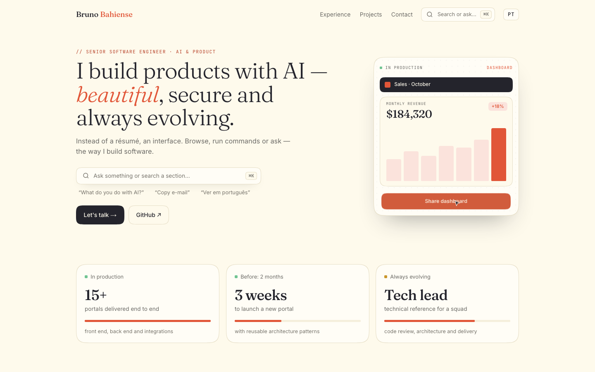

# 🧩 Bruno Bahiense — Portfolio

My personal site: an interface that shows how I build software instead of describing it.

**Live app:** [bluis.vercel.app](https://bluis.vercel.app/)



A bilingual (PT/EN) portfolio built like a product. A ⌘K Spotlight searches the site's own content, a hero panel assembles different products from the same components, and an Inspect mode reveals the components, design tokens and real build numbers behind the interface.

## Features

- **Spotlight (⌘K)** — keyboard-first search over sections, projects, roles, technologies and frequent questions; local and instant, with no AI and no per-use cost.
- **LiveBuild** — dashboard, report, automation, support and deals interfaces assembling in a loop; tilts in layers with the mouse and pauses when off-screen.
- **Inspect mode** — outlines every component, shows live size, padding and radius on hover, plus the design tokens and the build's version, commit and test results.
- **Micro-interactions** — magnetic buttons, squircle ripples, cursor-following card highlights and count-up metrics, all disabled under `prefers-reduced-motion`.
- **Bilingual by route** — `/pt` and `/en`, chosen by cookie or `Accept-Language`, with every string in typed locale files.

## Tech stack

- [Next.js 16](https://nextjs.org/) (App Router, Server Components, Turbopack)
- [React 19](https://react.dev/) and [TypeScript](https://www.typescriptlang.org/)
- CSS Modules with design tokens in CSS custom properties (squircle corners via `corner-shape`)
- [Vitest](https://vitest.dev/) and [Playwright](https://playwright.dev/)

No state management or UI library — Server Components for content and a few small client islands.

## Getting started

Requires Node.js 22.12+ and Yarn.

```bash
git clone https://github.com/brunolbahiense/bluis.git
cd bluis
yarn install
yarn dev
```

Open [http://localhost:3000](http://localhost:3000).

| Script          | Description                                                        |
| --------------- | ------------------------------------------------------------------ |
| `yarn dev`      | Start the development server                                       |
| `yarn build`    | Run unit tests, write build info and build for production          |
| `yarn start`    | Serve the production build                                         |
| `yarn lint`     | Run lint checks                                                    |
| `yarn test`     | Run unit tests                                                     |
| `yarn test:e2e` | Run end-to-end tests against `yarn start` (run `yarn build` first) |

## Project structure

```
src/
├── app/          # routes: /[locale] layout, page, not-found and OG image
├── components/   # one folder per component: index.tsx + styles.module.css
├── contexts/     # Spotlight and Inspector state
├── generated/    # build-info.json, written by the prebuild script
├── hooks/        # pointer, motion, hotkey and visibility hooks
├── lib/          # search, Spotlight catalog, locale choice, build info (pure + server-only reader)
├── locales/      # every string and data list, in pt and en
├── styles/       # design tokens, global styles and fonts
├── test/         # Vitest stub for server-only
├── types/        # ambient type declarations
└── proxy.ts      # redirects to /pt or /en
scripts/          # prebuild: runs tests and writes build info
tests/e2e/        # Playwright
```

## Author

Made by **Bruno Bahiense** — [GitHub](https://github.com/brunolbahiense) · [LinkedIn](https://www.linkedin.com/in/brunolbahiense/)
